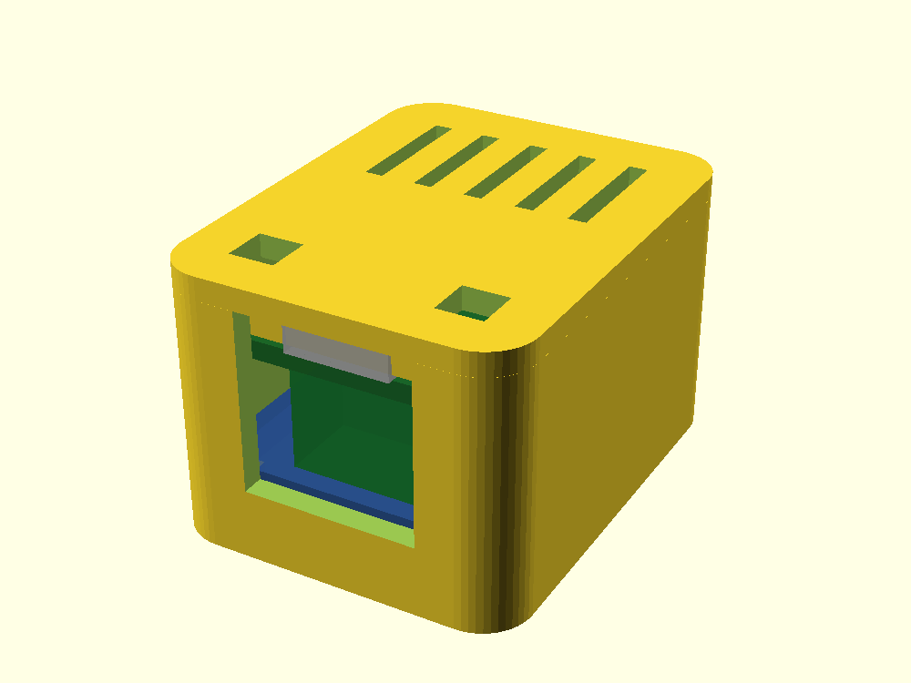

# Enclosure — LOLIN C3 mini + DIYLess OpenTherm Master Shield

A parametric, 3D-printable case for the two-board stack — the **LOLIN C3 mini on top**, the
**DIYLess OpenTherm Master Shield below**. Free-standing, two parts, no fasteners. The design and the
rationale for every choice are in [`docs/device/enclosure.md`](../../docs/device/enclosure.md);
this README is how to render, print, and assemble it.



The two `preview*.png` are rendered from the model (`preview.png` exterior, `preview-cut.png`
a cutaway with a translucent board mock) — regenerate them with the commands below.

## Files

| File | Role |
| --- | --- |
| `params.scad` | every dimension and tolerance — the only file you normally edit |
| `case.scad` | geometry (includes `params.scad`); do not hard-code numbers here |

No STL is committed — STL is a build output, regenerated on demand from these sources.

## What the case does

- Holds the stack on four floor posts (the **shield** rests on them, the **C3** rides above it
  on the headers); the cavity walls hold it laterally.
- **C3 on top:** the C3 is the upper board, so its USB-C, RST, BOOT and RGB LED all face **up** —
  reached from the top. The tall parts (KF128 terminal, optocouplers) sit in the ~10 mm gap
  between the boards, which is why the box is only ~24 mm tall.
- **Lid:** a window over the WS2812B status LED (a thin translucent membrane by default, or a
  through-hole via `led_through`) and a **poke-hole over each button** (press RST/BOOT with a pin
  through the hole). **Download mode works with the case closed** (hold BOOT, tap RST) — the
  reflashing path the boiler-idle-LOW caveat needs is preserved.
- **Front window:** USB-C (on the C3's top edge) and the KF128 "Boiler" terminal (down in the
  inter-board gap) exit the **same** short edge through one window; both cables leave here.
- **Vents** in the lid (back half). The DS18B20 is best mounted remotely on leads (vendor
  recommendation) so it senses the room, not the box — route its lead out the front window.

## Render and export

Needs [OpenSCAD](https://openscad.org/) (`openscad` on the PATH, or the app's CLI at
`/Applications/OpenSCAD.app/Contents/MacOS/OpenSCAD` on macOS).

```sh
# Preview the assembly (both shells + a translucent board mock) — open in the GUI:
openscad hardware/enclosure/case.scad

# Export each printable part to STL:
openscad -o base.stl -D 'part="base"' hardware/enclosure/case.scad
openscad -o lid.stl  -D 'part="lid"'  hardware/enclosure/case.scad
```

Override any parameter from the command line without editing the file, e.g. a measured gap:

```sh
openscad -o base.stl -D 'part="base"' -D 'board_gap=9.0' hardware/enclosure/case.scad
```

To inspect the internal fit, set `cut=true` — it slices the +X half away so the board mock,
the posts, and the openings are visible in section:

```sh
openscad -o cut.png -D 'part="assembly"' -D 'cut=true' hardware/enclosure/case.scad
```

## Print

- **Material: PETG** — the case may sit near a warm boiler; PLA softens.
- **Orientation:** print both parts flat, open face up — the **lid upside-down** (top plate on
  the bed, rim pointing up). No supports: the front window runs up to the rim (capped by the lid,
  no bridge), and the vents, LED and button holes are in a flat plate.
- **Settings:** 0.2 mm layers, ≥3 perimeters (the 2 mm walls fill at 5), 15–20 % infill.

## Assemble

1. Solder the stack with the 2.54 mm stackable headers and **trim the shield's down-pins nearly
   flush**; wire the two boiler leads into the KF128 (easier before assembly).
2. Drop the stack into the base — the **shield** rests on the four posts, the **C3** sits on top;
   the USB-C and the KF128 both face the front window.
3. Press the lid on; the rim grips by friction. Too loose or too tight → adjust `snap_fit`
   in `params.scad` (larger = looser) and reprint the lid.

## Tuning (first print)

The model ships with values from datasheets and from the owner's photos (see
`docs/device/enclosure.md`, "Dimensions"). A few are worth a caliper check on the assembled stack, because
they set the height and vary with build choices — override them on the command line or edit
`params.scad`:

- `board_gap` — the shield-top-to-C3-bottom distance (holds the KF128; the biggest height driver).
- `below_h` — clearance under the shield for the trimmed down-pins.
- `led_x` / `led_y`, `btn_hole_x` / `btn_hole_y` — the LED and button positions on the C3 top,
  if the lid holes do not line up on the first print.

Everything else (fit, wall, clearances) is a printer-tolerance tweak, not a measurement.
